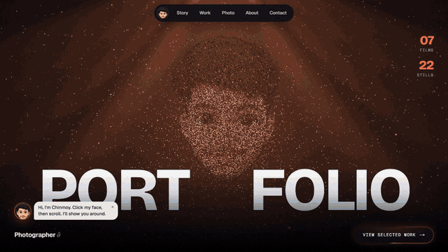
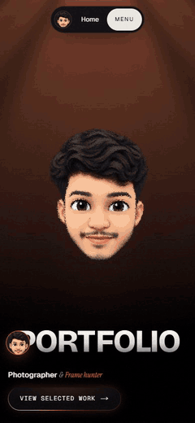
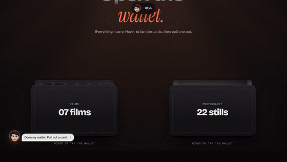

<div align="center">

<a href="https://starlit-arithmetic-38f269.netlify.app">
  
</a>

<br /><br />

*I capture moments that deserve to stay.*

### 🌐 Live at [starlit-arithmetic-38f269.netlify.app](https://starlit-arithmetic-38f269.netlify.app)

<a href="https://starlit-arithmetic-38f269.netlify.app"></a>

<br />

<a href="https://starlit-arithmetic-38f269.netlify.app"></a>
<a href="https://www.instagram.com/chinmoy_clickings/"></a>
<a href="mailto:chinmoykashyapthakuria@gmail.com"></a>

<br /><br />

[**Story**](https://starlit-arithmetic-38f269.netlify.app/#story) &nbsp;·&nbsp;
[**Work**](https://starlit-arithmetic-38f269.netlify.app/#work) &nbsp;·&nbsp;
[**Photography**](https://starlit-arithmetic-38f269.netlify.app/#photo) &nbsp;·&nbsp;
[**About**](https://starlit-arithmetic-38f269.netlify.app/#about) &nbsp;·&nbsp;
[**Contact**](https://starlit-arithmetic-38f269.netlify.app/#contact)

</div>


## It starts with one drop

<div align="center">
  
  <br />
  <sub>A dot, a bounce, an exclamation mark, a name. Tap or press any key to skip it.</sub>
</div>

## Then the page comes alive

<table>
  <tr>
    <td width="72%" align="center"><br /><sub><b>On a laptop</b></sub></td>
    <td width="28%" align="center"><br /><sub><b>On a phone</b></sub></td>
  </tr>
</table>

<div align="center">
  
  <br />
  <sub>Selected work lives in a wallet. Fan the cards, then pull one out.</sub>
</div>

## Walk through it

Every link jumps straight to that scene on the live site.

| Scene | What happens |
| --- | --- |
| [**Hero**](https://starlit-arithmetic-38f269.netlify.app/) | A 3D avatar under animated light rays that watches the cursor, blinks, spins on click and bursts apart on scroll |
| **Navigation** | A dynamic island with a scroll progress ring and the current chapter, plus an avatar guide who talks you through the page |
| [**Intro**](https://starlit-arithmetic-38f269.netlify.app/#about) | A 3D model of Chinmoy's Sony α6400 and 18–135mm lens behind the intro: drag to turn it, click to fire the shutter, and scroll to zoom the lens and flip the screen |
| [**What I Can Do**](https://starlit-arithmetic-38f269.netlify.app/#services) | A bento grid with 3D tilt, drifting stars and click ripples |
| [**The Story**](https://starlit-arithmetic-38f269.netlify.app/#story) | A lens opens as you scroll, then your choice jumps to that part of the gallery |
| [**Selected Work**](https://starlit-arithmetic-38f269.netlify.app/#work) | Two digital wallets, one of films and one of stills: pull a film card to play it |
| [**Films**](https://starlit-arithmetic-38f269.netlify.app/#films) | A 3D reel of seven films: drag it, the front one plays, and each opens full screen at its original quality |
| **3D Ring** | Stills on a scroll-driven cylinder; click any frame to open it |
| [**Photography**](https://starlit-arithmetic-38f269.netlify.app/#photo) | A masonry gallery of 22 stills in their real shapes, in five categories, opening as the original files |
| [**One More Thing**](https://starlit-arithmetic-38f269.netlify.app/#play) | A playable pixel breakout of the name |
| [**Contact**](https://starlit-arithmetic-38f269.netlify.app/#contact) | Interactive light tubes (click to change their colours), copy-to-clipboard email and Instagram |

**Films:** Mumbai · Sunburn Campus 2026 · Consensio · Prayer Flags · Campus Days · College ke Campus · From Above

**Stills:** Concerts · Portraits · Fashion · Events · Landscapes

Every photograph and film on the site is Chinmoy's own work, served as the original files.


## Smooth on every screen

| | |
| --- | --- |
| **Quiet intro** | The 3D loads first, so the intro plays with nothing competing behind it |
| **Power-aware effects** | Light rays, the 3D hero and the tubes scale down or switch off on slower devices |
| **Split loading** | Sections below the fold load in small pieces, and photos decode off the main thread |
| **Every size** | Layouts recomposed for phones, tablets, landscape phones and 4K rather than shrunk |
| **Never blank** | The hero shows the avatar image if WebGL is unavailable |
| **Accessible** | Reduced motion respected, full keyboard support, visible focus and alt text |
| **Offline shell** | A small service worker keeps the basics available |

## Built with

<div align="center">


</div>

## Run it locally

```bash
npm install
```

```bash
npm run dev
```

Then open [localhost:3000](http://localhost:3000).

<details>
<summary><b>Update the content</b></summary>

<br />

All content lives in `src/data`, so nothing needs changing inside the components.

| Change | Edit |
| --- | --- |
| Photographs | [`src/data/photos.ts`](src/data/photos.ts) and [`public/media/work/photos/`](public/media/work/photos) |
| Films | [`src/data/videos.ts`](src/data/videos.ts) and [`public/media/work/films/`](public/media/work/films) |
| Email and Instagram | [`src/data/social.ts`](src/data/social.ts) |
| Name, about text, web address | [`src/data/site.ts`](src/data/site.ts) |

[`public/media/README.md`](public/media/README.md) lists every file and the recommended sizes.

</details>

<details>
<summary><b>Project structure</b></summary>

<br />

```text
src/
  app/          routes, metadata, sitemap and robots
  sections/     one file per page section
  components/   cursor, loader, wallet, rays, transitions, viewer, player
  animations/   shared easing and transition vocabulary
  three/        the 3D avatar, the α6400 camera and the photo ring
  data/         all site content, ready for a CMS
public/media/   images, films and textures
docs/           the banner and recordings in this README
```

</details>

<details>
<summary><b>Building on a Windows PC with Application Control</b></summary>

<br />

The scripts use webpack with `@next/swc-wasm-nodejs`, because this project was developed on a machine that blocks Next's native compiler and `sharp`. When `sharp` can't load, `next.config.mjs` serves images unoptimized. Netlify optimizes them as normal.

</details>

<br />

<div align="center">

<a href="https://starlit-arithmetic-38f269.netlify.app/#contact">
  
</a>

<br /><br />

**[Live site](https://starlit-arithmetic-38f269.netlify.app)** &nbsp;·&nbsp; [Instagram](https://www.instagram.com/chinmoy_clickings/) &nbsp;·&nbsp; [chinmoykashyapthakuria@gmail.com](mailto:chinmoykashyapthakuria@gmail.com)

<sub>© 2026 Chinmoy Clickings</sub>

</div>
