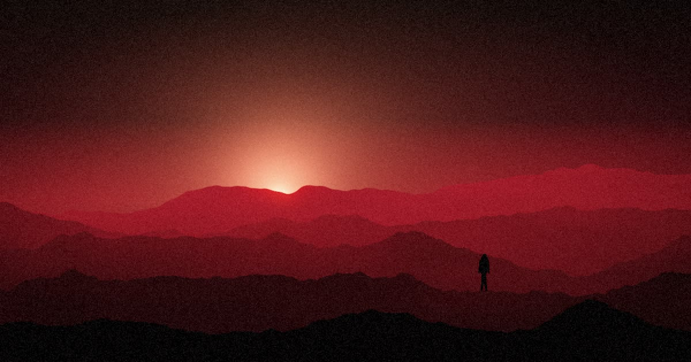
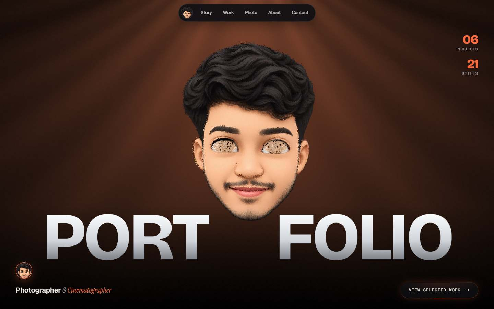
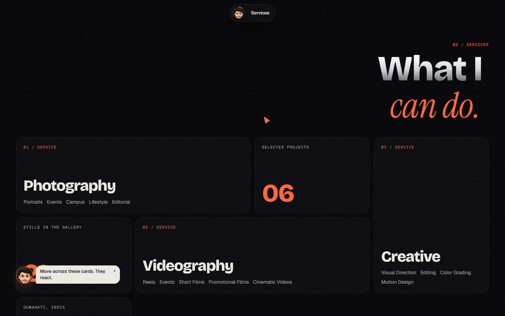
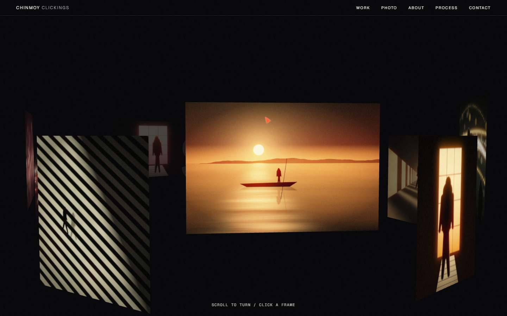
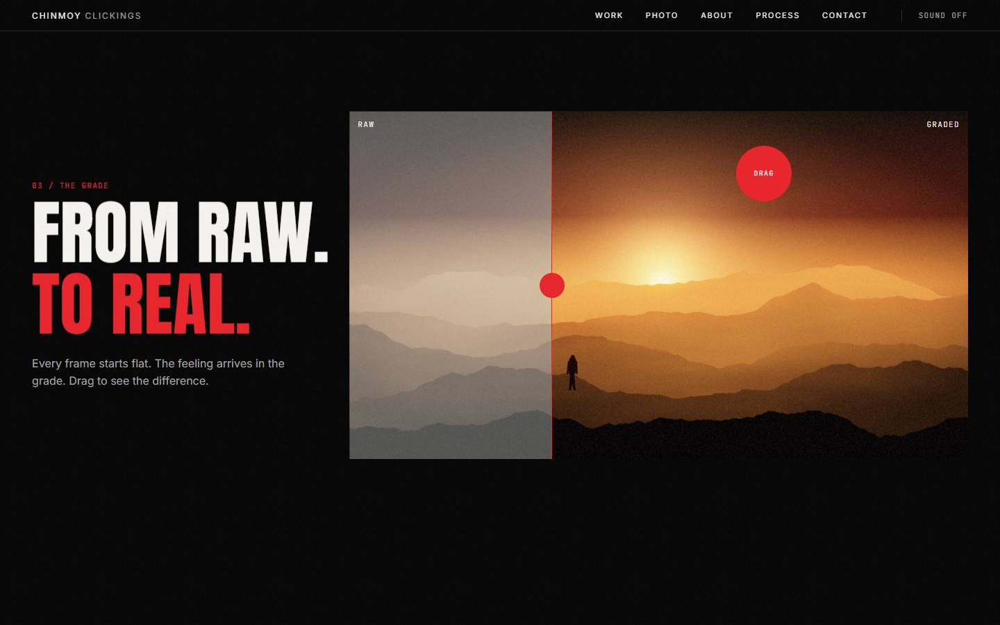

<div align="center">



# CHINMOY CLICKINGS

*I capture moments that deserve to stay.*

Photography · Cinematography · Visual Stories
<br />
Guwahati, India

### [**View the live website →**](https://starlit-arithmetic-38f269.netlify.app)

[](https://starlit-arithmetic-38f269.netlify.app)
[](https://www.instagram.com/chinmoy_clickings/)


</div>

> [!NOTE]
> Apart from Chinmoy's portrait, the photographs, films and project text on the site are generated placeholders. Real work is on its way.

---

## The experience

A 3D, heavily animated portfolio in onyx, chrome and molten coral.

<table>
  <tr>
    <td width="50%"></td>
    <td width="50%"></td>
  </tr>
  <tr>
    <td></td>
    <td></td>
  </tr>
</table>

| Scene | What happens |
| --- | --- |
| **Loader** | A dot bounces, rises into "!", levers out CHINMOY, then the name turns into PORTFOLIO letter by letter |
| **Hero** | The portrait as a 3D point cloud that bursts into place, tilts and parts around the cursor |
| **Intro** | Chrome type, scroll-lit words, spotlight glass cards and a two-way craft marquee |
| **What I Can Do** | An accordion of services |
| **Selected Work** | Frames that swing up in 3D on scroll and tilt under the cursor |
| **3D Ring** | Stills on a scroll-driven cylinder; click any frame to open it |
| **Photography** | A filterable gallery of 21 stills with a full lightbox |
| **From Raw. To Real.** | A draggable, keyboard-operable before and after of a real portrait edit |
| **The Journey** | A red timeline that fills as you scroll |
| **One More Thing** | A playable pixel breakout of the name |
| **Contact** | Live WebGL smoke, copy-to-clipboard email and Instagram |

## Built for everyone

- **Dedicated mobile layouts,** recomposed for tall screens rather than shrunk
- **Graceful fallbacks:** the hero becomes a CSS 3D tilt if WebGL is unavailable, and is never blank
- **Reduced motion respected** throughout
- **Full keyboard support,** visible focus, captions and alt text
- **Responsive AVIF and WebP images,** lazy video and a dynamically loaded hero scene
- **Offline shell** through a small service worker

## Stack

Next.js · React · TypeScript · Tailwind CSS · GSAP · Framer Motion · Three.js · custom WebGL shaders

> The intro plays on every visit to the home page. Tap or press any key to skip it.

## Run it locally

```bash
npm install
npm run dev
```

## Project structure

```text
src/
  app/          routes, metadata, sitemap and robots
  sections/     one file per page section
  components/   cursor, loader, transitions, viewer, player
  animations/   shared easing and transition vocabulary
  three/        the particle portrait and 3D photo ring
  data/         all site content, ready for a CMS
public/media/   images, films and textures
```

## Updating the content

All content lives in `src/data`, so nothing needs changing inside the components.

| Change | Edit |
| --- | --- |
| Projects | `src/data/projects.ts` and `public/media/projects/` |
| Photographs | `src/data/photos.ts` and `public/media/photography/` |
| Films | `src/data/videos.ts` and `public/media/videos/` |
| Email and Instagram | `src/data/social.ts` |
| Name, about text, web address | `src/data/site.ts` |

[`public/media/README.md`](public/media/README.md) lists every file and the recommended sizes.

<details>
<summary>Building on a Windows PC with Application Control</summary>

The scripts use webpack with `@next/swc-wasm-nodejs`, because this project was developed on a machine that blocks Next's native compiler and `sharp`. When `sharp` can't load, `next.config.mjs` serves images unoptimized. Netlify optimizes them as normal.

</details>

---

<div align="center">

**[starlit-arithmetic-38f269.netlify.app](https://starlit-arithmetic-38f269.netlify.app)** · [@chinmoy_clickings](https://www.instagram.com/chinmoy_clickings/) · [chinmoykashyapthakuria@gmail.com](mailto:chinmoykashyapthakuria@gmail.com)

© 2026 Chinmoy Clickings

</div>
